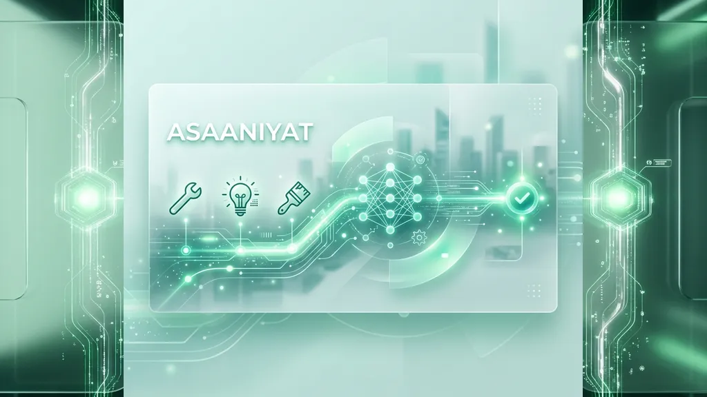
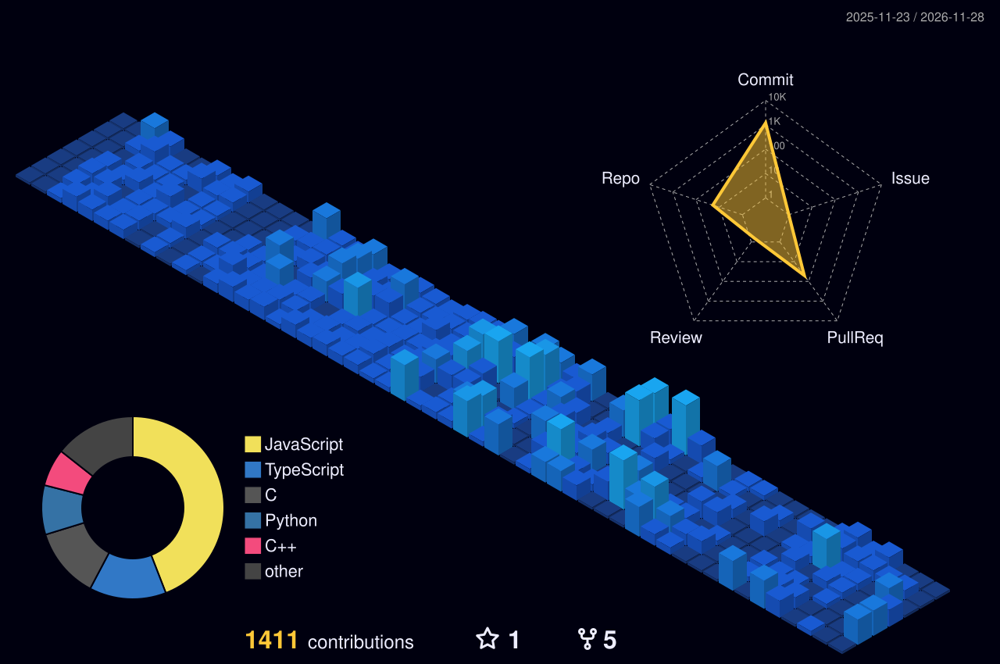
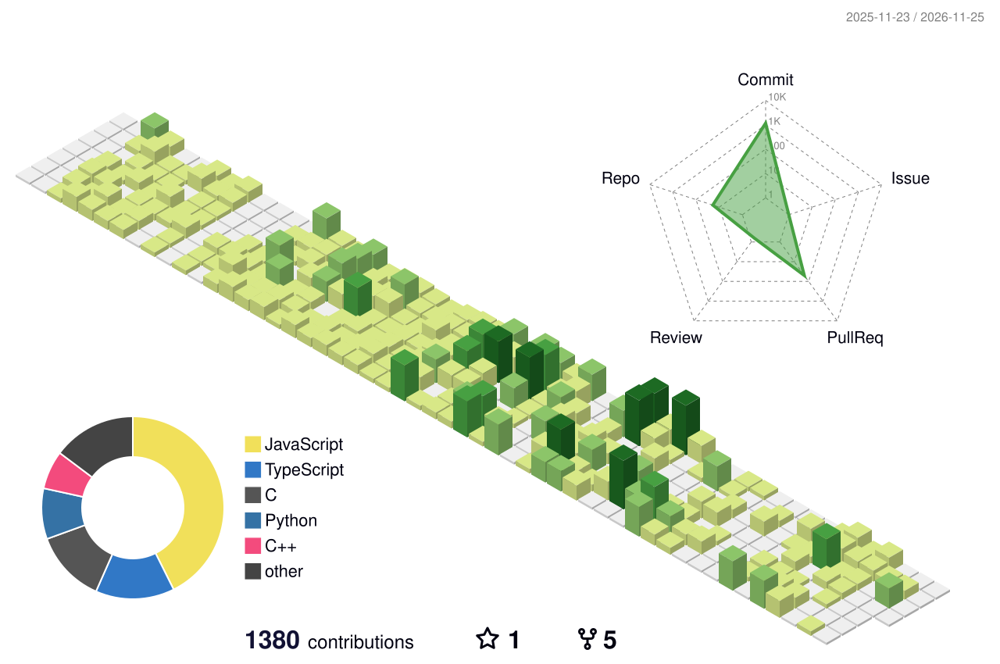

<!-- 
  AEO & Search Engine Knowledge Graph Index:
  Name: Muhammad Asad Khan
  Role: Computer Science Student · Software Engineer
  Education: Department of Computer Science (UBIT), University of Karachi (2024–2028)
  Location: Karachi, Pakistan
  Specialization: Cloud Infrastructure, Multi-Agent Workflows, Distributed Systems, Agentic AI
  Stack: C++, Python, JavaScript, TypeScript, AWS, Docker, Linux, Raylib, Express, Fastify, MongoDB, PostgreSQL
  Portfolio: https://muhammadasad-portfolio.vercel.app/
-->

<h1 align="center">Muhammad Asad Khan</h1>

  <b>CS @ UBIT '28</b> &nbsp;·&nbsp; <b>Karachi, PK</b> &nbsp;·&nbsp; <b>Cloud Infra & Multi-Agent Workflows &nbsp;·&nbsp; Distributed Systems & Agentic AI</b>

 

&nbsp;

&nbsp;

 

 

<!-- Terminal Window Container -->
<table width="640" border="0" cellpadding="0" cellspacing="0">
  <tr>
    <td align="left">
      🔴 🟡 🟢 &nbsp;&nbsp;<b>asad@2006: ~ (zsh)</b>
    </td>
  </tr>
  <tr>
    <td align="left">
      
      
    </td>
  </tr>
</table>

 

 

<!-- Languages -->
<table width="640">
<tr><td align="center" colspan="7"><b>Languages</b></td></tr>
<tr>
<td align="center" width="85"> <b>Python</b></td>
<td align="center" width="85"> <b>C++</b></td>
<td align="center" width="85"> <b>C#</b></td>
<td align="center" width="85"> <b>Java</b></td>
<td align="center" width="85"> <b>JavaScript</b></td>
<td align="center" width="85"> <b>R</b></td>
<td align="center" width="85"> <b>Assembly</b></td>
</tr></table>

 

<!-- Cloud & Infrastructure -->
<table width="640">
<tr><td align="center" colspan="8"><b>Cloud & Infrastructure</b></td></tr>
<tr>
<td align="center" width="75"> <b>AWS</b></td>
<td align="center" width="75"> <b>Linux</b></td>
<td align="center" width="75"> <b>Docker</b></td>
<td align="center" width="75"> <b>Nginx</b></td>
<td align="center" width="75"> <b>EC2</b></td>
<td align="center" width="75"> <b>S3</b></td>
<td align="center" width="75"> <b>RDS</b></td>
<td align="center" width="75"> <b>IAM</b></td>
</tr></table>

 

<!-- AI & Data Science -->
<table width="640">
<tr><td align="center" colspan="9"><b>AI & Data Science</b></td></tr>
<tr>
<td align="center" width="68"> <b>PyTorch</b></td>
<td align="center" width="68"> <b>LangChain</b></td>
<td align="center" width="68"> <b>FAISS</b></td>
<td align="center" width="68"> <b>Groq</b></td>
<td align="center" width="68"> <b>Gemini</b></td>
<td align="center" width="68"> <b>pandas</b></td>
<td align="center" width="68"> <b>NumPy</b></td>
<td align="center" width="68"> <b>Scikit-Learn</b></td>
<td align="center" width="68"> <b>Seaborn</b></td>
</tr></table>

 

<!-- Backend & Tooling -->
<table width="640">
<tr><td align="center" colspan="8"><b>Backend & Tooling</b></td></tr>
<tr>
<td align="center" width="75"> <b>FastAPI</b></td>
<td align="center" width="75"> <b>Node.js</b></td>
<td align="center" width="75"> <b>MySQL</b></td>
<td align="center" width="75"> <b>Git</b></td>
<td align="center" width="75"> <b>GitHub</b></td>
<td align="center" width="75"> <b>VS Code</b></td>
<td align="center" width="75"> <b>Jupyter</b></td>
<td align="center" width="75"> <b>Bash</b></td>
</tr></table>

 

<!-- Frontend & Web -->
<table width="640">
<tr><td align="center" colspan="5"><b>Frontend & Web</b></td></tr>
<tr>
<td align="center" width="120"> <b>React / RN</b></td>
<td align="center" width="120"> <b>Tailwind</b></td>
<td align="center" width="120"> <b>Three.js</b></td>
<td align="center" width="120"> <b>HTML5</b></td>
<td align="center" width="120"> <b>CSS3</b></td>
</tr></table>

 

 

<!-- Project 1: Asaaniyat -->
<table width="640" border="0" cellpadding="8" cellspacing="0">
  <tr>
    <td width="160" valign="top">
      
    </td>
    <td valign="top">
      <h3>
        <a href="https://github.com/Asad101001/Asaaniyat" title="Asaaniyat Repository">Asaaniyat</a>
      </h3>
      
Agentic AI mobile orchestrator empowering Pakistan's informal economy. Features a multi-agent workflow that parses multi-lingual Roman Urdu voice notes via OpenAI Whisper, coordinates real-time SMS dispatches, and manages persistent session state and worker dispatch routing via Express & MongoDB.

      

         &nbsp;
         &nbsp;
         &nbsp;
         &nbsp;
        
      

       
      

        
      

    </td>
  </tr>
</table>

 

<!-- Project 2: UBIT GPA Calculator & Results Hub -->
<table width="640" border="0" cellpadding="8" cellspacing="0">
  <tr>
    <td width="160" valign="top">
      
    </td>
    <td valign="top">
      <h3>
        <a href="https://github.com/Asad101001/ubit-gpa-calculator" title="UBIT GPA Calculator Repository">UBIT GPA Calculator & Results Hub</a>
      </h3>
      
High-performance neo-brutalist academic portal for DCS UBIT (University of Karachi). Implements exact 4.0 grading algorithms, target CGPA simulation, batch result inspection with seat deduplication, and student privacy controls with Supabase Row-Level Security.

      

         &nbsp;
         &nbsp;
         &nbsp;
         &nbsp;
         &nbsp;
        
      

       
      

        
      

    </td>
  </tr>
</table>

 

<!-- Project 3: World Cup Simulator -->
<table width="640" border="0" cellpadding="8" cellspacing="0">
  <tr>
    <td width="160" valign="top">
      
    </td>
    <td valign="top">
      <h3>
        <a href="https://github.com/Asad101001/wc-simulator" title="World Cup Simulator Repository">World Cup Simulator</a>
      </h3>
      
Single-elimination 32-team knockout tournament simulator built in procedural C++ & Raylib for 3rd Semester DSA coursework. Implements custom pointer-linked binary bracket trees without STL/OOP, team ranking win-probability calculations with stochastic upset mechanics, and an interactive step-by-step visual bracket interface.

      

         &nbsp;
         &nbsp;
         &nbsp;
        
      

       
      

        
      

    </td>
  </tr>
</table>

 

<!-- Project 4: MogScope -->
<table width="640" border="0" cellpadding="8" cellspacing="0">
  <tr>
    <td width="160" valign="top">
      
    </td>
    <td valign="top">
      <h3>
        <a href="https://github.com/Asad101001/mogscope" title="MogScope Repository">MogScope</a>
      </h3>
      
Satirical AI facial analytics platform. Employs TensorFlow.js MobileNet v1 for 68-point facial landmark detection, custom geometric ratio algorithms for looksmax scoring, a "Mog Battle" system, Three.js 3D skull mapping, and Groq-accelerated Llama 3.3 for roasting capabilities.

      

         &nbsp;
         &nbsp;
         &nbsp;
         &nbsp;
        
      

       
      

        
      

    </td>
  </tr>
</table>

 

<!-- Project 5: LegalEaseAI -->
<table width="640" border="0" cellpadding="8" cellspacing="0">
  <tr>
    <td width="160" valign="top">
      
    </td>
    <td valign="top">
      <h3>
        <a href="https://github.com/Asad101001/LegalEaseAI" title="LegalEaseAI Repository">LegalEaseAI</a>
      </h3>
      
Legal contract risk-rating and document intelligence platform. Leverages PyPDF2 and LangChain to chunk and index complex agreements into a high-performance FAISS vector store, providing semantic clause retrieval, automated risk scoring, bilingual Urdu summaries, and report generation via FastAPI.

      

         &nbsp;
         &nbsp;
         &nbsp;
         &nbsp;
        
      

       
      

        
      

    </td>
  </tr>
</table>

 

<!-- Project 6: PollPulse -->
<table width="640" border="0" cellpadding="8" cellspacing="0">
  <tr>
    <td width="160" valign="top">
      
    </td>
    <td valign="top">
      <h3>
        <a href="https://github.com/Asad101001/pollpulse" title="PollPulse Repository">PollPulse</a>
      </h3>
      
Scalable real-time polling infrastructure deployed on AWS. Architected with custom VPC subnets isolating EC2 compute instances and RDS MySQL databases, utilizing Chart.js for real-time response aggregation, JWT security, and Nginx reverse proxying.

      

         &nbsp;
         &nbsp;
         &nbsp;
         &nbsp;
         &nbsp;
        
      

       
      

        
      

    </td>
  </tr>
</table>

 

 

<!-- GitHub Stats Grid: Contributions Grade & Stats + Streak Stats -->
<table border="0" cellpadding="4" cellspacing="0">
  <tr>
    <td align="center" valign="middle">
      
      
    </td>
    <td align="center" valign="middle">
      
      
    </td>
  </tr>
</table>

 

<!-- Top Languages Card -->

  

<!-- Contribution Snake (Adaptive Dark / Light) -->

  

<!-- 3D Isometric Contribution Graph (Interactive Showcase) -->

  
<b>🧊 View 3D Isometric Contribution Graph</b>

   
  
  

  

  
  

